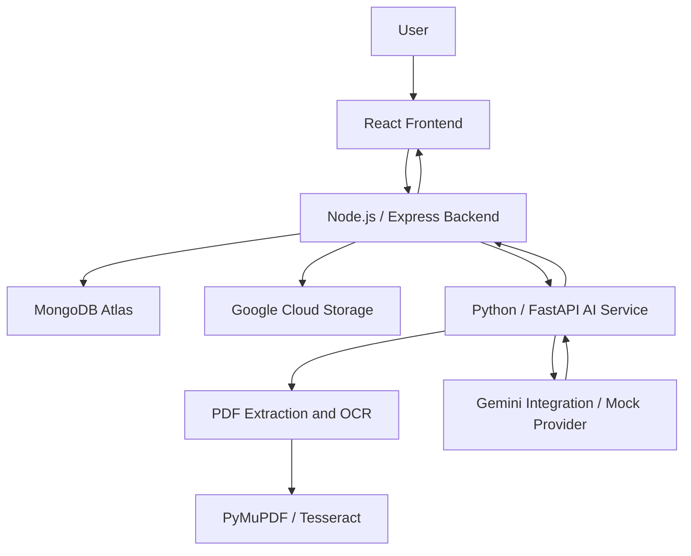

# NyayaSetu (न्यायसेतु) — AI-Powered Legal Research & Document Intelligence Platform

**Making legal information more accessible, understandable, and actionable.**

NyayaSetu is an AI-powered legal document intelligence platform designed to simplify the way individuals and legal professionals interact with complex legal documents. It transforms lengthy legal PDFs into structured, easy-to-understand insights through document analysis, contextual question answering, procedural timelines, FAQs, and intelligent legal research assistance.

By combining document processing, OCR, natural language understanding, and a conversational interface, NyayaSetu aims to bridge the gap between complex legal language and accessible legal information.

[Live Application](https://nyayasetu-frontend-emrl3zqkeq-el.a.run.app) · [Report a Bug](../../issues) · [Request a Feature](../../issues)

---

## Table of Contents

- [The Problem](#the-problem)
- [Our Solution](#our-solution)
- [Application Preview](#application-preview)
- [Key Features](#key-features)
- [User Roles](#user-roles)
- [System Architecture](#system-architecture)
- [Technology Stack](#technology-stack)
- [How It Works](#how-it-works)
- [Project Structure](#project-structure)
- [Getting Started](#getting-started)
- [Environment Configuration](#environment-configuration)
- [Deployment](#deployment)
- [Testing](#testing)
- [Security Considerations](#security-considerations)
- [Future Scope](#future-scope)
- [Disclaimer](#disclaimer)

---

## The Problem

Legal documents are often difficult to understand, even for individuals who regularly interact with them.

Court orders, judgments, contracts, notices, and other legal documents frequently contain:

- Dense legal terminology and complex language.
- Lengthy paragraphs that make important information difficult to locate.
- Procedural details scattered across multiple pages.
- Important dates, obligations, and clauses that are easy to overlook.
- Information that requires considerable time and legal expertise to interpret.

For citizens, understanding a legal document can be overwhelming. For legal professionals, manually reviewing large volumes of documents can consume valuable time that could otherwise be spent on research and case preparation.

**The challenge is not simply accessing legal information. It is understanding it efficiently.**

## Our Solution

NyayaSetu provides a unified platform that converts unstructured legal documents into organized, actionable information.

Users can upload legal PDF documents and receive structured insights, including:

- Plain-language document summaries.
- Important facts, clauses, and legal provisions.
- Frequently asked questions based on document content.
- Chronological timelines of important events.
- Procedural flowcharts.
- Actionable points and key takeaways.
- Lawyer-oriented argument mapping.
- Context-aware conversational interaction with document references.

The platform also incorporates role-based access control, document management, administrative oversight, and audit logging.

The objective is to make legal information easier to navigate without replacing professional legal judgment.

---

## Application Preview

> Replace the image paths below with your actual screenshots. Create a `screenshots/` directory in the repository and add your images there.

### 1. Landing Page

An introduction to NyayaSetu and its approach to making legal information more accessible.


### 2. Authentication

Secure registration and login experience.


### 3. User Dashboard

A centralized workspace for accessing documents and their associated insights.


### 4. Document Upload

Upload legal PDF documents for extraction and analysis.


### 5. AI-Powered Document Analysis

Transform lengthy legal documents into structured summaries, important clauses, facts, and key insights.


### 6. Procedural Timeline

Understand important events and procedural developments through a chronological representation.


### 7. Legal Process Flowchart

Visualize procedural information through structured flowcharts.


### 8. Document-Grounded Chat

Ask questions about an uploaded document and receive contextual answers with page references.


### 9. Lawyer Workspace

Access lawyer-oriented insights and argument mapping.


---

## Key Features

### 1. Intelligent PDF Processing

- Upload legal documents in PDF format.
- Extract text from digitally generated PDFs using PyMuPDF.
- Apply Tesseract OCR as a fallback for scanned documents.
- Validate uploaded files before processing.
- Process extracted content for downstream analysis.

### 2. Structured Legal Document Analysis

Convert unstructured legal content into meaningful information through AI-assisted analysis.

The platform supports:

- Plain-language summaries.
- Identification of important facts.
- Extraction of relevant clauses.
- Frequently asked questions.
- Chronological event timelines.
- Procedural flowcharts.
- Action items and key takeaways.

### 3. Document-Grounded Conversational AI

Interact with uploaded legal documents through a conversational interface.

Users can:

- Ask questions about document contents.
- Retrieve relevant information without manually searching through pages.
- Receive context-aware responses.
- Access page-level references supporting answers.

### 4. Lawyer-Oriented Argument Mapping

Provide legal professionals with a structured way to examine document contents and organize relevant arguments.

### 5. Role-Based Access Control

NyayaSetu supports three distinct user roles:

- **Citizen:** Access document upload, analysis, and conversational assistance.
- **Lawyer:** Access legal document intelligence and lawyer-oriented analysis.
- **Admin:** Manage users and review platform audit logs.

### 6. Document and Analysis Persistence

- Persist document and analysis records.
- Maintain access to previously generated insights.
- Associate analysis results with their corresponding documents.

### 7. Administrative Management

- User management.
- Role-based authorization.
- Audit logging.
- Administrative oversight.

---

## User Roles

| Capability | Citizen | Lawyer | Admin |
|---|:---:|:---:|:---:|
| User authentication | Yes | Yes | Yes |
| Upload legal documents | Yes | Yes | As authorized |
| Document analysis | Yes | Yes | As authorized |
| Document-grounded chat | Yes | Yes | As authorized |
| Lawyer-oriented argument mapping | — | Yes | As authorized |
| User management | — | — | Yes |
| Audit log access | — | — | Yes |

*Access is governed by the application's role-based authorization rules.*

---

## System Architecture

NyayaSetu follows a modular, service-oriented architecture that separates the frontend, backend API, and AI processing layer.



### Architecture Components

**Frontend — React + Vite**

Provides the user interface for authentication, document management, analysis visualization, and conversational interaction.

**Backend — Node.js + Express**

Acts as the primary application API gateway. It handles authentication, authorization, document management, persistence, and communication with the AI service.

**AI Microservice — Python + FastAPI**

Handles document extraction, OCR workflows, structured analysis, and document-grounded conversational processing.

**Database — MongoDB Atlas**

Stores application data, user information, document metadata, and persisted analysis results.

**Object Storage — Google Cloud Storage**

Provides cloud-based storage for uploaded legal PDF documents.

**AI Integration — Google Gemini**

The application includes a Gemini integration for AI-assisted legal document analysis and conversational workflows, alongside a deterministic mock provider for development and demonstration.

---

## Technology Stack

| Layer | Technologies |
|---|---|
| Frontend | React, Vite, Tailwind CSS |
| Backend | Node.js, Express.js |
| AI Service | Python, FastAPI |
| AI Integration | Google Gemini, Google Gen AI SDK |
| Database | MongoDB Atlas, Mongoose |
| Document Processing | PyMuPDF |
| OCR | Tesseract |
| Authentication | JWT, bcrypt |
| Validation | Zod, Pydantic |
| Cloud Platform | Google Cloud Platform |
| Application Hosting | Google Cloud Run |
| Object Storage | Google Cloud Storage |
| Containerization | Docker |
| Container Registry | Google Artifact Registry |
| Secret Management | Google Cloud Secret Manager |
| Testing | Jest, Supertest, Pytest |

---

## How It Works

### Step 1: Authentication

Users register or log in through the application. Access to protected resources is controlled through JWT-based authentication and role-based authorization.

### Step 2: Document Upload

The user uploads a legal PDF through the frontend.

The backend validates the document and stores the uploaded file in the configured storage location.

### Step 3: Text Extraction

The AI microservice processes the uploaded document.

- PyMuPDF extracts text from digitally generated PDFs.
- Tesseract OCR provides an extraction fallback for scanned documents.

### Step 4: Document Analysis

The extracted content is passed through the analysis pipeline to generate structured legal insights.

### Step 5: Visualization

The frontend presents the generated insights in an organized format, including summaries, FAQs, timelines, flowcharts, and other relevant information.

### Step 6: Conversational Interaction

Users can ask questions about their uploaded documents. The system uses document context to generate responses with supporting page references.

---

## Project Structure

The repository follows a modular structure:

```text
NyayaSetu/
│
├── src/
│   ├── frontend/
│   │   ├── src/
│   │   ├── public/
│   │   ├── Dockerfile
│   │   └── nginx.conf.template
│   │
│   ├── backend/
│   │   ├── src/
│   │   ├── tests/
│   │   └── Dockerfile
│   │
│   └── ai_service/
│       ├── app/
│       ├── tests/
│       ├── requirements.txt
│       └── Dockerfile
│
├── tests/
├── docs/
├── docker-compose.yml
├── .env.example
├── .gitignore
└── README.md
```

*Individual filenames and directories may evolve as the project develops.*

---

## Getting Started

Follow these instructions to run NyayaSetu locally.

### Prerequisites

Ensure the following tools are installed:

- Node.js and npm
- Python 3.11+
- MongoDB Atlas account or a local MongoDB instance
- Tesseract OCR
- Git
- Docker (optional, for containerized execution)

### 1. Clone the Repository

```bash
git clone <YOUR_GITHUB_REPOSITORY_URL>
cd NyayaSetu
```

### 2. Configure Environment Variables

Use the provided `.env.example` files as a reference.

Create the necessary environment files for the frontend, backend, and AI service based on their respective configuration requirements.

Do not commit actual credentials or API keys.

### 3. Start the Backend

```bash
cd src/backend
npm install
npm run dev
```

### 4. Start the AI Service

In a separate terminal:

```bash
cd src/ai_service

python -m venv venv
source venv/bin/activate

pip install -r requirements.txt

uvicorn main:app --reload --host 0.0.0.0 --port 8000
```

### 5. Start the Frontend

In another terminal:

```bash
cd src/frontend
npm install
npm run dev
```

Open the local URL displayed by Vite in your browser.

> **Note:** The commands above assume the conventional development entry points. Refer to the service-specific configuration and package scripts if your local setup uses different entry points or environment variables.

---

## Environment Configuration

NyayaSetu uses environment variables to separate configuration from application code.

The following are the principal configuration values to account for:

| Variable | Purpose |
|---|---|
| `MONGODB_URI` | MongoDB Atlas connection URI |
| `JWT_SECRET` | JWT signing secret |
| `AI_INTERNAL_API_KEY` | Internal backend-to-AI service authentication |
| `AI_SERVICE_URL` | AI microservice URL |
| `GEMINI_API_KEY` | Gemini API credential when using live AI |
| `MOCK_GEMINI_IN_DEV` | Controls the existing mock provider configuration |
| `CORS_ORIGIN` | Permitted frontend origin |
| `PORT` | Backend server port |
| `AI_PORT` | AI service port |

Check the respective service configuration for any additional required variables.

**Never commit `.env` files, database credentials, JWT secrets, or API keys to GitHub.**

For cloud deployments, use Google Cloud Secret Manager rather than hardcoding credentials into source code or container images.

---

## Deployment

NyayaSetu is deployed on **Google Cloud Platform using Cloud Run**.

The application is separated into three independently deployed services.

| Service | Deployment | Responsibility |
|---|---|---|
| Frontend | Google Cloud Run | React application served through Nginx |
| Backend | Google Cloud Run | Express API gateway |
| AI Service | Google Cloud Run | FastAPI document processing and AI workflows |

### Production Infrastructure

- **Compute:** Google Cloud Run
- **Container Registry:** Google Artifact Registry
- **Document Storage:** Google Cloud Storage
- **Database:** MongoDB Atlas
- **Secrets:** Google Cloud Secret Manager
- **Region:** Mumbai (`asia-south1`)

### Live Application

[Open NyayaSetu](https://nyayasetu-frontend-emrl3zqkeq-el.a.run.app)

The backend and AI service communicate through a service-to-service authentication setup. The AI service is configured for private Cloud Run access, while the frontend and backend are independently deployed.

---

## Testing

Testing is performed across the backend, AI microservice, and frontend build pipeline.

### Backend Testing

- Authentication and authorization.
- Document management.
- Administrative operations.
- Analysis and chat workflows.
- AI service client authentication.

**Testing framework:** Jest and Supertest.

### AI Service Testing

- PDF extraction.
- OCR workflows.
- Analysis endpoints.
- Conversational endpoints.
- Mock-provider workflows.

**Testing framework:** Pytest.

### Frontend Verification

- Production build validation.
- Application rendering.
- Integration with backend APIs.
- End-to-end feature verification.

Run the individual test suites from their respective service directories according to their package and Python configuration.

---

## Security Considerations

Security is an important part of NyayaSetu's architecture.

The platform incorporates:

- JWT-based authentication.
- Password hashing using bcrypt.
- Role-based access control.
- Protected application routes.
- Backend-controlled API operations.
- Internal service authentication.
- Cloud Run IAM authentication for backend-to-AI communication.
- Secret management through Google Cloud Secret Manager.
- File upload validation.
- Audit logging.
- Restricted access to the AI microservice.

Production deployments should also use appropriately restricted database network access, least-privilege cloud IAM permissions, secure secret rotation, and HTTPS.

---

## Future Scope

NyayaSetu is designed to evolve into a more comprehensive legal intelligence platform.

Potential future enhancements include:

- Integration with verified legal databases and case-law repositories.
- Advanced semantic search across judgments and legal documents.
- Retrieval-Augmented Generation (RAG) for larger document collections.
- Improved multilingual document understanding.
- Cross-document comparison and analysis.
- Citation verification and legal precedent discovery.
- Advanced lawyer research workflows.
- Document version comparison.
- Collaborative case workspaces.
- Enhanced evaluation of AI-generated legal responses.

---

## Disclaimer

NyayaSetu is an informational and research-assistance platform.

The information generated by the application is intended to help users understand legal documents and organize relevant information. It does not constitute legal advice, establish an attorney-client relationship, or replace consultation with a qualified legal professional.

AI-generated outputs may contain inaccuracies, omissions, or misinterpretations. Users should independently verify important information and consult qualified legal professionals before making legal decisions.

---

## Contributing

Contributions, suggestions, and feedback are welcome.

If you would like to contribute:

1. Fork the repository.
2. Create a feature branch.
3. Implement your changes.
4. Run the relevant tests.
5. Submit a pull request describing your contribution.

For bugs and feature requests, use the GitHub Issues section.

---

## Built With Purpose

**NyayaSetu — Bridging the gap between complex legal language and accessible legal understanding.**

Designed and developed with the goal of making legal information more approachable through software engineering, document intelligence, and AI-assisted research.


