# Software Project Management Plan (SPMP) — NyayaSetu

## 1. Introduction and Objectives
The Software Project Management Plan defines the technical management, resource allocation, scheduling, and risk management strategies for **NyayaSetu**. NyayaSetu is an AI-powered legal intelligence platform that assists citizens and legal professionals in understanding complex legal documents.

Development is structured into two sequential phases:
- **Phase 1: Backend and AI Service Development (Current Scope)**
- **Phase 2: Frontend Development (Scheduled upon Phase 1 sign-off)**

## 2. Project Organization and Team Roles
The project utilizes a cross-functional engineering team structure:
- **Project Manager (PM):** Milestone governance, communication cadence, risk tracking.
- **Lead Architect:** Architectural integrity, API contracts, microservice separation of concerns.
- **Backend Developer:** Node.js Express server, MongoDB integration, JWT/RBAC security.
- **AI/ML Engineer:** Python FastAPI service, PyMuPDF extraction, OCR fallback, Gemini integration.
- **Database Engineer:** MongoDB schema design, indexing, data integrity, audit logging.
- **Security Engineer:** Threat modeling, prompt injection defenses, input sanitization.
- **QA/Test Engineer:** Automated test authoring (Jest, Supertest, Pytest), CI pipeline.

## 3. Work Breakdown Structure (WBS)
The project breakdown follows a sequential handoff strategy:

| Task ID | Task Description | Planned Duration | Predecessors | Phase |
|---|---|---|---|---|
| A1 | Requirements Engineering & System Design | 2 weeks | None | Phase 1 |
| A2.1 | Core Node.js API & MongoDB Infrastructure | 2 weeks | A1 | Phase 1 |
| A2.2 | Document Management & PDF/OCR Pipeline | 2 weeks | A2.1 | Phase 1 |
| A2.3 | Gemini AI Integration & Prompt Engineering | 2 weeks | A2.2 | Phase 1 |
| A2.4 | Document Grounded Chat & Admin Module | 2 weeks | A2.3 | Phase 1 |
| A3 | Testing, CI/CD Setup & API Documentation | 2 weeks | A2.4 | Phase 1 |
| B1 | Phase 2 UI/UX Wireframing & Design Systems | 2 weeks | A3 | Phase 2 |
| B2 | React & Tailwind Client Development | 4 weeks | B1 | Phase 2 |
| B3 | End-to-End System Integration & QA | 2 weeks | B2 | Phase 2 |
| B4 | Production Deployment & User Manual Finalization | 1 week | B3 | Phase 2 |

## 4. Project Schedule and Milestones
The project schedule spans 14 weeks for Phase 1 and 9 weeks for Phase 2.

```mermaid
flowchart LR
    A1["A1: Requirements & Design (2w)"] --> A2["A2: Backend & AI Development (8w)"]
    A2 --> A3["A3: API Testing & Validation (2w)"]
    A3 --> M1["Milestone M1: Phase 1 Complete (v1.0)"]
    M1 --> B1["B1: UI/UX Wireframes (2w)"]
    B1 --> B2["B2: React Frontend Dev (4w)"]
    B2 --> B3["B3: E2E Integration (2w)"]
    B3 --> B4["B4: Cloud Release (1w)"]
    B4 --> M2["Milestone M2: NyayaSetu v2.0 Live"]
```

### Key Milestones
- **M1 (Phase 1 Baseline):** Backend API server, AI microservice, MongoDB schemas, and test suites fully operational with >= 80% automated coverage.
- **M2 (Phase 2 Baseline):** Responsive web interface connected to backend APIs with interactive flowchart visualization.
- **M3 (Final Delivery):** Complete documentation, containerized cloud deployment, and user manual delivery.

## 5. Technical Resource and Cost Estimates
- **Development Environment:** Local development workstations running Node.js 18+, Python 3.11+, and MongoDB.
- **Cloud Infrastructure:**
  - Database: MongoDB Atlas (M0 Free Tier cluster).
  - Compute: Render.com or Google Cloud Run (Containerized service tier).
  - AI Engine: Google Gemini API (Generative Language API free/pay-as-you-go quota).
- **Cost Impact:** Minimal, leveraging cloud free tiers and developer credits.

## 6. Quality Assurance and Configuration Management
- **Source Control:** Git with GitHub repository.
  - `main`: Production-ready, verified baseline.
  - `develop`: Integration branch for active features.
  - `feature/*`: Short-lived feature branches.
- **Quality Gates:**
  - Automated linting (ESLint, Prettier, Ruff/Flake8).
  - Automated tests running on GitHub Actions CI.
  - Minimum test code coverage: 80% on backend and AI service business logic.
- **Change Management:** All modifications to schemas or endpoints must update the Requirements Traceability Matrix (`docs/21_requirements_traceability_matrix.md`) and API specifications.

## 7. Risk Management Summary
| Risk ID | Risk Description | Probability | Impact | Mitigation Strategy |
|---|---|---|---|---|
| R1 | Gemini API Hallucinations | Medium | High | Strict prompts with `[UNKNOWN]` placeholders, temperature 0.2, schema validation |
| R2 | Large or Scanned PDF Processing Bottlenecks | Medium | Medium | PyMuPDF streaming extraction, async chunking, OCR fallback caching |
| R3 | Prompt Injection via Malicious PDFs | Medium | High | Treat PDF text as untrusted data, delimiter fencing, instruction stripping |
| R4 | Cloud Free Tier Quota Limits | Low | Medium | Efficient token usage, local response caching, query throttling |

## 8. Communication and Reporting Plan
- Daily engineering standups and task board tracking.
- Formal milestone review gates between Phase 1 and Phase 2.
- Continuous documentation maintenance within the repository `docs/` folder.

