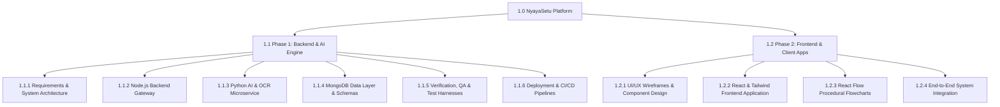

# Work Breakdown Structure (WBS) — NyayaSetu

## 1. Overview
The Work Breakdown Structure decomposes the complete engineering lifecycle of **NyayaSetu** into discrete, manageable work packages across Phase 1 (Backend & AI) and Phase 2 (Frontend).

## 2. Work Breakdown Structure Hierarchy

## 3. Detailed Work Packages (Phase 1 Focus)

### 1.1.1 Requirements & System Architecture (Task A1)
- **1.1.1.1 Requirements Engineering:** Formulate SRS, SPMP, FRD, and NFRD aligned with IEEE standards.
- **1.1.1.2 Architectural Specification:** Design microservice contracts, OpenAPI definitions, and data flow models.
- **1.1.1.3 Security & AI Ethics Guidelines:** Establish prompt safety rules, placeholder conventions, and RBAC policies.
- **1.1.1.4 Traceability Matrix:** Establish bi-directional requirements-to-test mapping.

### 1.1.2 Node.js Backend API Gateway (Task A2.1)
- **1.1.2.1 Project Scaffolding:** Express.js setup, CORS, helmet, Morgan logging, Winston logger.
- **1.1.2.2 Authentication Subsystem:** JWT generation, verification, bcrypt hashing, refresh strategies.
- **1.1.2.3 RBAC Middlewares:** Role gating for `citizen`, `lawyer`, and `admin`.
- **1.1.2.4 File Ingestion Controller:** Multer stream validation, magic number checks, file size throttling.
- **1.1.2.5 AI Service Client:** Axios-based internal client with circuit breaking and retries.
- **1.1.2.6 Admin Governance APIs:** User state management, audit log streaming, system diagnostics.

### 1.1.3 Python AI & OCR Microservice (Task A2.2 & A2.3)
- **1.1.3.1 FastAPI Scaffolding:** Application lifecycle, Pydantic v2 schemas, CORS, internal API security.
- **1.1.3.2 Document Extraction Pipeline:** PyMuPDF (`fitz`) text and metadata parser.
- **1.1.3.3 OCR Fallback Engine:** Page rasterization and Tesseract OCR engine for scanned PDFs.
- **1.1.3.4 Gemini Client Integration:** Google GenAI SDK integration with temperature tuning and rate limiter.
- **1.1.3.5 Prompt Templates:** Parameterized templates for summaries, FAQs, flowcharts, timelines, and arguments.
- **1.1.3.6 Conversational Grounded Engine:** Chunk matching, prompt fencing, and page citation extraction.

### 1.1.4 MongoDB Data Layer & Schemas (Task A2.4)
- **1.1.4.1 Mongoose Schemas:** `User`, `Document`, `AnalysisResult`, `ChatSession`, `ChatMessage`, `SystemLog`.
- **1.1.4.2 Indexes & Constraints:** Compound indexes on `(userId, createdAt)`, unique constraints on email.
- **1.1.4.3 Data Access Layer:** Repository layer enforcing tenant ownership filtering on all queries.

### 1.1.5 Verification, QA & Test Harnesses (Task A3)
- **1.1.5.1 Backend Unit & Integration Tests:** Jest and Supertest suite covering all REST endpoints.
- **1.1.5.2 AI Microservice Tests:** Pytest suite testing extraction, prompt formatting, and schema validation.
- **1.1.5.3 Mocking Infrastructure:** Mock Gemini API responses for deterministic, zero-cost continuous integration.
- **1.1.5.4 Malicious Input Testing:** Test suites for malformed PDFs, oversized files, and prompt injection attacks.

### 1.1.6 Deployment & CI/CD Pipelines (Task A3)
- **1.1.6.1 Containerization:** Dockerfiles for Backend and AI service; docker-compose for local testing.
- **1.1.6.2 GitHub Actions Workflows:** Automated linting, test execution, and container validation.
- **1.1.6.3 Environment Configuration:** Multi-environment variable templates and deployment guides.

## 4. Work Package Responsibility Matrix
| Work Package ID | Work Package Title | Lead Role | Reviewer |
|---|---|---|---|
| 1.1.1 | Requirements & Architecture | Lead Architect | Project Manager |
| 1.1.2 | Node.js Backend Gateway | Backend Developer | Lead Architect |
| 1.1.3 | Python AI & OCR Microservice | AI/ML Engineer | Lead Architect |
| 1.1.4 | MongoDB Data Layer | Database Engineer | Backend Developer |
| 1.1.5 | Testing & QA Harnesses | QA Engineer | Lead Architect |
| 1.1.6 | Deployment & CI/CD | DevOps/Backend | Project Manager |

