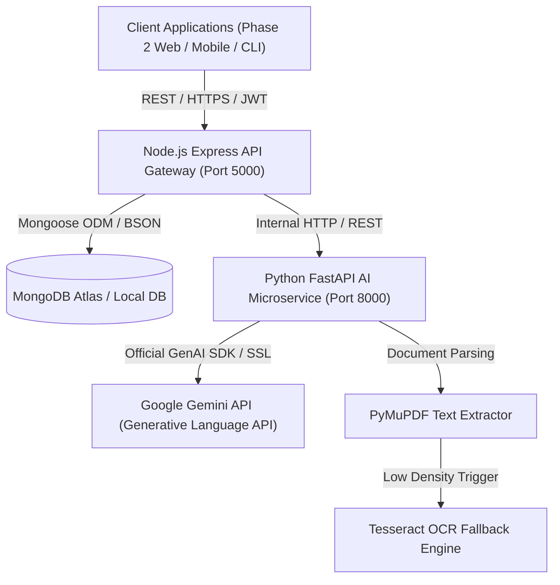

# Software Architecture Document — NyayaSetu

## 1. Architectural Overview and Style
**NyayaSetu** employs a decoupled, service-oriented microservices architecture. The system separates high-throughput client API gateway operations (Node.js/Express) from compute- and AI-intensive document parsing and inference workloads (Python/FastAPI).

## 2. Component Decomposition and Responsibilities

### 2.1 Node.js Express API Gateway (`src/backend`)
- **Primary Role:** Public-facing entry point for all client requests.
- **Key Responsibilities:**
  1. User authentication, password encryption via `bcrypt`, and JWT token issuance/verification.
  2. Role-based authorization policies (`citizen`, `lawyer`, `admin`).
  3. File upload validation (MIME type verification, magic number inspection, 25MB size limits).
  4. Orchestration of document workflow states (`uploaded`, `extracting`, `ready`, `failed`).
  5. Proxying and dispatching AI analysis and chat queries to the internal AI microservice.
  6. Data persistence for Users, Documents, AnalysisResults, ChatSessions, ChatMessages, and SystemLogs.
  7. Centralized logging and error handling.

### 2.2 Python FastAPI AI Microservice (`src/ai_service`)
- **Primary Role:** High-performance internal document intelligence engine.
- **Key Responsibilities:**
  1. PDF text and structural metadata extraction using PyMuPDF (`fitz`).
  2. Fallback rasterization and optical character recognition using Tesseract OCR for scanned documents.
  3. Chunking, semantic windowing, and context passage retrieval for conversational Q&A.
  4. Gemini API prompt assembly, boundary fence injection, and temperature regulation.
  5. Strict schema enforcement and output validation using Pydantic v2 models.
  6. Internal health reporting.

### 2.3 MongoDB Data Layer
- **Primary Role:** Flexible, scalable document datastore.
- **Key Responsibilities:**
  1. Stores normalized user records, document references, and audit logs.
  2. Stores structured JSON outputs of legal analyses (summaries, FAQs, flowchart nodes, timelines, arguments).
  3. Supports sub-document embedding for chat histories and procedural steps.

## 3. Communication Patterns and Protocols
- **Client to Backend Gateway:** RESTful HTTPS, JSON request/response payloads, Bearer JWT authentication header.
- **Backend Gateway to AI Microservice:** Private HTTP/REST within local network or internal virtual network; protected by internal API key and CORS isolation.
- **AI Microservice to Google Gemini:** Official Google Cloud Generative AI SDK over outbound TLS 1.3 HTTPS.

## 4. Architectural Decisions and Technology Justification
| Component | Selected Technology | Alternative Considered | Justification |
|---|---|---|---|
| API Gateway | Node.js / Express.js | Python / Django | Non-blocking asynchronous I/O ideal for file uploads, auth streaming, and web routing. |
| AI Engine | Python / FastAPI | Node.js LangChain | Python ecosystem provides native C-bindings for PyMuPDF (`fitz`), Pillow, OpenCV, and official Google GenAI SDK. |
| Database | MongoDB | PostgreSQL | Legal analysis outputs (flowcharts, argument maps, dynamic JSON FAQs) map natively to BSON document collections. |
| AI Foundation | Google Gemini 2.0 / Pro | Local Llama / Mistral | Gemini provides superior legal reasoning, multi-page context windows, and official Google Cloud developer support. |

## 5. Security and Cross-Cutting Concerns
- **Zero Public AI Exposure:** The Python AI microservice is not directly accessible from the public internet; all traffic must traverse the Express API gateway with verified JWT credentials.
- **Strict Data Isolation:** Multi-tenant document ownership checks are applied in the backend controller layer before delegating any document processing.
- **Stateless Services:** Both the Node.js gateway and Python AI service are completely stateless, allowing horizontal container replica scaling.

