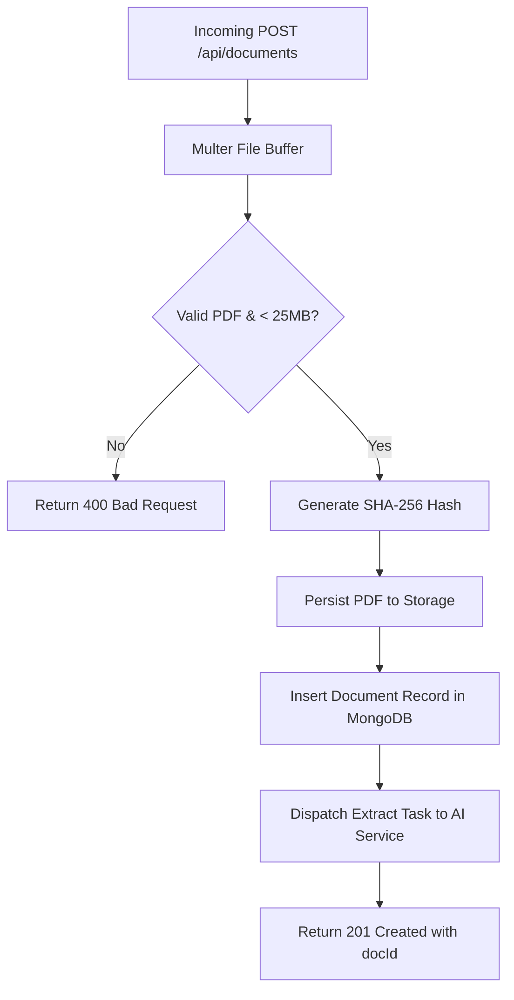
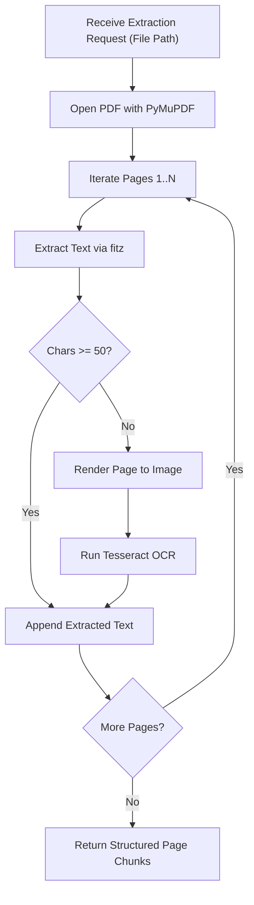

# System Design Document (SDD) — NyayaSetu

## 1. System Overview and Modularity
The **NyayaSetu** system design details the internal mechanisms of each subsystem, data flow pipelines, error handling pathways, and interface boundaries between components.

## 2. Subsystem Detailed Design

### 2.1 Ingestion Subsystem (Node.js Gateway)
- **File Receiver:** Uses `multer` configured with memory or disk temporary buffers.
- **Header Validator:** Inspects initial bytes for `%PDF-` signature. Rejects invalid MIME payloads with HTTP 400.
- **Hash Generator:** Computes SHA-256 fingerprint for document deduplication and integrity auditing.
- **Storage Handler:** Stores validated PDFs in local storage or object bucket with permissions restricted to the backend process.



### 2.2 Extraction & OCR Subsystem (Python AI Service)
- **PyMuPDF Pipeline:** Opens PDF using `fitz.open()`. Extracts text per page alongside page metadata, bounding rects, and character counts.
- **OCR Fallback Trigger:** Evaluates whether page text yield is below 50 characters. If true, converts page to raster pixmap (`fitz.Page.get_pixmap()`) and executes Tesseract OCR (`pytesseract.image_to_string()`).
- **Sanitization & Normalization:** Strips zero-width characters, normalizes Unicode whitespace, and truncates excessive line-breaks.



### 2.3 Legal Analysis Engine (Gemini Integration)
- **Prompt Structuring:** System instructions enforce legal persona, forbidding speculative reasoning.
- **Execution:** Calls Gemini `generate_content` (or `stream_generate_content`) passing system prompt, safety settings, and bounded document text.
- **Pydantic Validation:** Raw JSON response from Gemini is deserialized and validated against `DocumentAnalysisResponseSchema`.
- **Database Persistence:** Validated analysis payload is transferred back to Node.js backend and saved in the `AnalysisResults` collection.

### 2.4 Document-Grounded Chat Subsystem
- **Passage Retrieval:** User query is compared against stored page chunks using lexical/semantic ranking.
- **Grounded Prompt Assembly:** Top relevant chunks are assembled into a fenced context block:
  ```
  [DOCUMENT_CONTEXT]
  Page 1: ...
  Page 2: ...
  [/DOCUMENT_CONTEXT]
  ```
- **Gemini Inference:** System prompt directs Gemini to answer solely from `[DOCUMENT_CONTEXT]`. If missing, output `[UNKNOWN]`.
- **Response Parsing:** Extracts `answer`, `citedPages: [int]`, and appends the message pair to `ChatMessages`.

## 3. Resilience, Circuit Breaking, and Retries
1. **AI Service Call Timeouts:** Gateway sets a 30-second timeout on AI inference requests.
2. **Gemini Exponential Backoff:** The Python service intercepts HTTP 429/503 errors from Gemini and applies jittered exponential backoff (initial delay: 1s, max delay: 10s, max retries: 3).
3. **Database Reconnection:** Mongoose handles auto-reconnect with exponential backoff on intermittent network disconnects.

