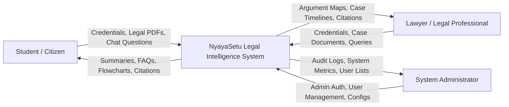
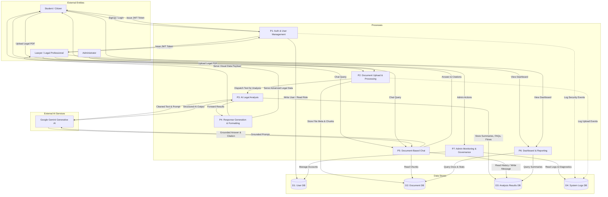
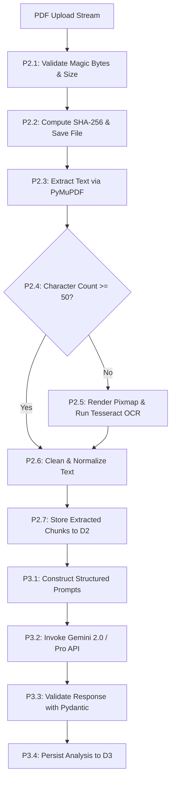

# Data Flow Diagrams (DFD) — NyayaSetu

## 1. DFD Level 0 (Context Diagram)
The Context Diagram establishes the boundary of the **NyayaSetu** system, illustrating external entities and primary information exchanges.

## 2. DFD Level 1 (Detailed Subsystem Data Flows)
Level 1 illustrates processes P1 through P7, data stores D1 through D4, and cross-subsystem data movements (matching Executive Summary Figure 3).

## 3. Data Store Definitions

| Store ID | Name | Primary Contents | Storage Engine |
|---|---|---|---|
| D1 | User DB | User credentials (bcrypt hash), role, contact info, account status | MongoDB (`users` collection) |
| D2 | Document DB | File metadata, checksums, physical paths, extracted text page chunks | MongoDB (`documents` collection) |
| D3 | Analysis Results DB | Structured summaries, FAQs, flowchart nodes, timelines, arguments, chat messages | MongoDB (`analysis_results`, `chat_sessions`, `chat_messages`) |
| D4 | System Logs DB | Security events, audit trail, extraction errors, API access logs | MongoDB (`system_logs` collection) |

## 4. DFD Level 2: Document Processing and AI Pipeline Deep-Dive

