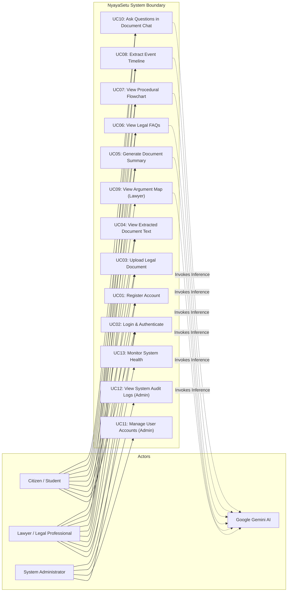

# UML Use Case Diagram and Specifications — NyayaSetu

## 1. Use Case Diagram
The following diagram models the interactions between human actors, system processes, and external services in **NyayaSetu**.

## 2. Detailed Use Case Specifications

### UC03: Upload Legal Document
- **Primary Actor:** Authenticated Citizen or Lawyer.
- **Preconditions:** User is logged in with a valid JWT token.
- **Main Success Scenario:**
  1. User sends `POST /api/documents` with a PDF file in multi-part form data.
  2. Gateway validates file format (MIME `application/pdf`, magic bytes `%PDF-`) and size (<= 25MB).
  3. System saves physical file to secure storage and computes SHA-256 checksum.
  4. Metadata record created in `Documents` collection with status `"uploaded"`.
  5. Asynchronous text extraction pipeline triggered.
  6. System returns HTTP 201 with `docId`, filename, and upload timestamp.
- **Alternative Scenarios:**
  - *Invalid File Format:* System returns HTTP 400 Bad Request ("Only PDF files are supported").
  - *File Exceeds Limit:* System returns HTTP 413 Payload Too Large ("File size exceeds 25MB limit").

### UC05: Generate Document Summary & Analysis
- **Primary Actor:** Authenticated Citizen or Lawyer.
- **Preconditions:** Document has completed extraction (`status: "ready"`).
- **Main Success Scenario:**
  1. User requests `GET /api/analysis/:id`.
  2. If pre-computed analysis exists in `AnalysisResults`, system returns cached JSON.
  3. Otherwise, system sends document text to AI microservice `/analyze`.
  4. AI service formats prompt, calls Google Gemini API with temperature 0.2.
  5. AI service validates response against Pydantic schema and returns JSON.
  6. Backend persists analysis in `AnalysisResults` and returns HTTP 200.
- **Alternative Scenarios:**
  - *Document Still Extracting:* Returns HTTP 409 Conflict ("Document extraction in progress").
  - *Gemini Upstream Error:* Returns HTTP 503 Service Unavailable with retry guidance.

### UC10: Ask Questions in Document Chat
- **Primary Actor:** Authenticated Citizen or Lawyer.
- **Preconditions:** User owns the target document and document extraction is ready.
- **Main Success Scenario:**
  1. User submits `POST /api/chat/:id` with query message.
  2. System retrieves relevant text passages and prior conversational turns.
  3. System constructs grounded prompt with explicit boundary fences and citations.
  4. Gemini generates response citing page numbers.
  5. System appends query and answer to `ChatMessages`.
  6. System returns answer, cited pages, and legal disclaimer.
- **Alternative Scenarios:**
  - *Fact Not Found in Document:* AI model returns answer indicating fact is unknown with `[UNKNOWN]` placeholder.
  - *Unauthorized User:* If user does not own document, system returns HTTP 403 Forbidden.

