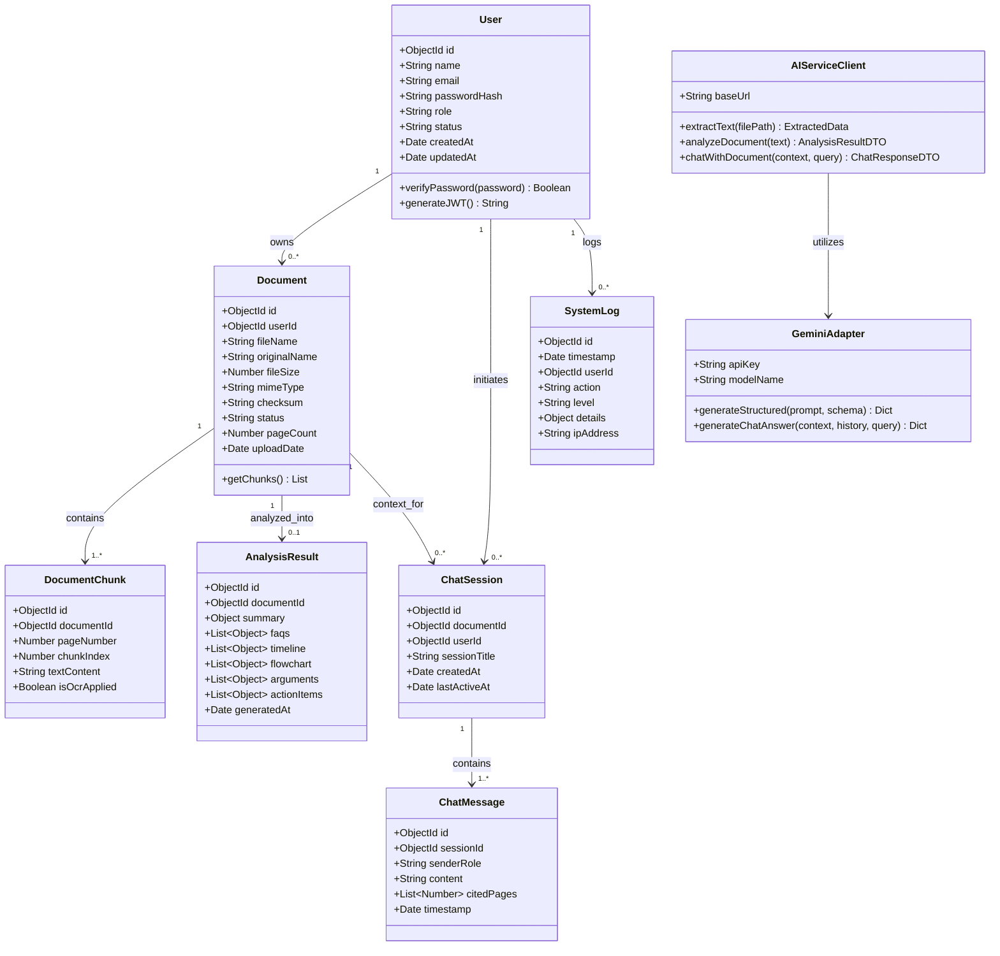

# UML Class Diagram — NyayaSetu

## 1. Class Diagram Architecture
The class diagram represents the object-oriented structure of the **NyayaSetu** backend and AI microservice, showing relationships, attributes, and core methods.

## 2. Pydantic Validation Schemas (AI Microservice)

### SummarySchema
- `dispute_type`: str
- `key_parties`: list[str]
- `factual_background`: list[str]
- `legal_issues`: list[str]
- `rulings_or_obligations`: list[str]
- `plain_language_summary`: str

### FAQItemSchema
- `question`: str
- `answer`: str
- `relevant_clause_or_page`: str

### TimelineEventSchema
- `date`: str
- `event`: str
- `source_page`: int

### FlowchartStepSchema
- `step_number`: int
- `stage_name`: str
- `description`: str
- `action_required`: str
- `deadline_or_timeframe`: str

### ArgumentItemSchema
- `claim`: str
- `evidence_or_basis`: str
- `counter_argument`: str

### ChatResponseSchema
- `answer`: str
- `cited_pages`: list[int]
- `confidence`: str
- `disclaimer`: str

