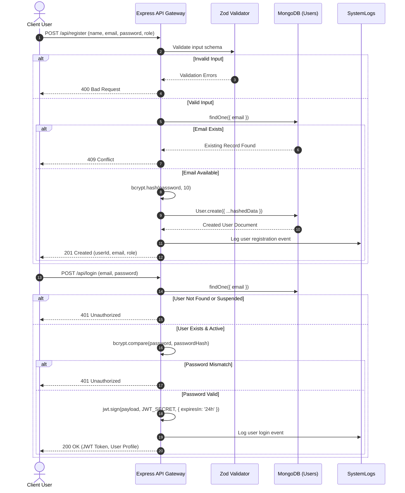
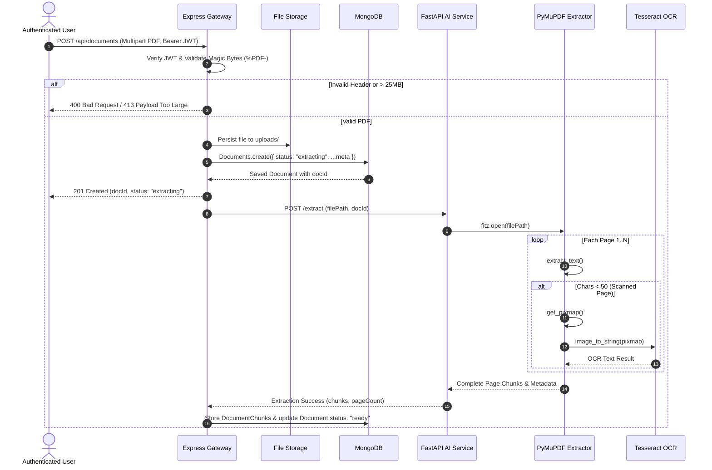
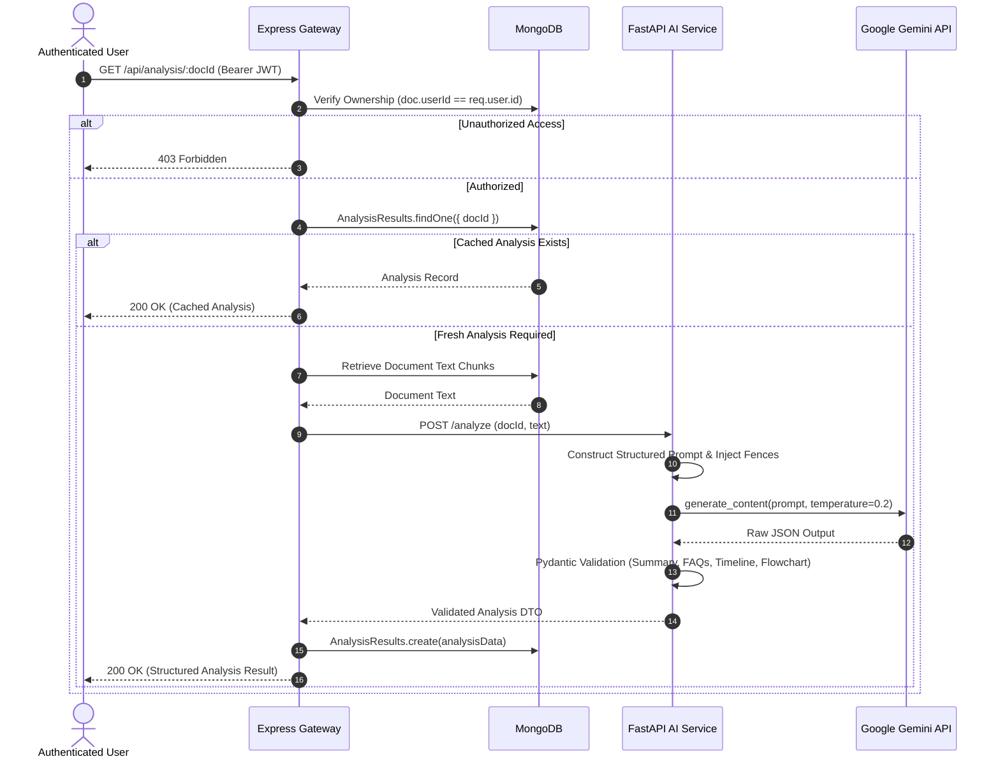
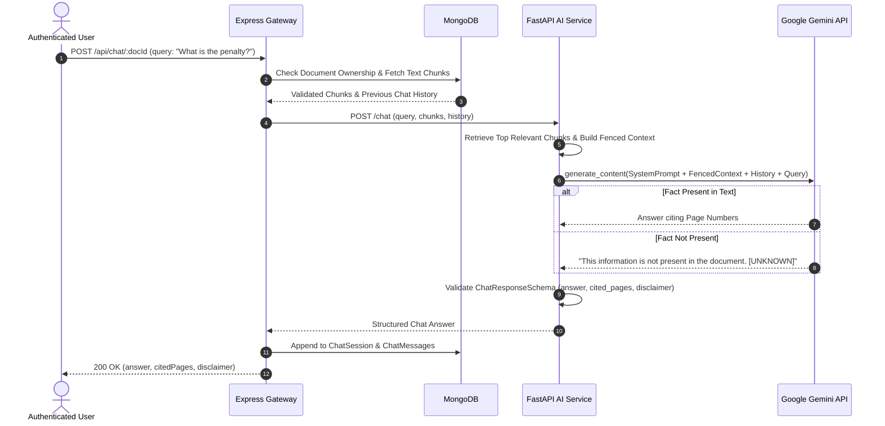

# UML Sequence Diagrams — NyayaSetu

## 1. Sequence Diagram 1: User Registration and Authentication

## 2. Sequence Diagram 2: Document Upload and Text/OCR Extraction

## 3. Sequence Diagram 3: AI Document Analysis (Gemini Integration)

## 4. Sequence Diagram 4: Document-Grounded Conversational Chat

