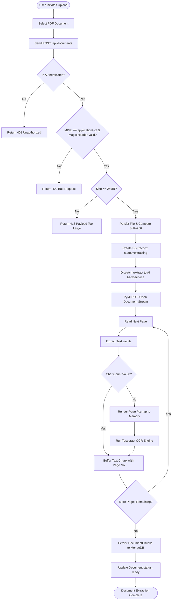
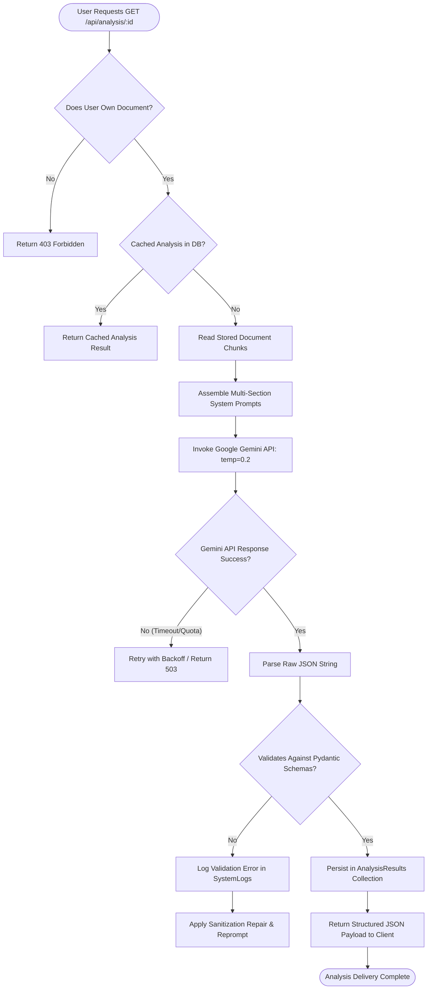

# UML Activity Diagrams — NyayaSetu

## 1. Activity Diagram 1: Document Ingestion and Extraction Workflow



## 2. Activity Diagram 2: Legal Analysis Generation and Pydantic Validation



## 3. Activity Diagram 3: Document Chat and Hallucination Prevention

```mermaid
flowchart TD
    StartChat([User Enters Chat Query]) --> CheckDocAccess{User Document Verified?}
    CheckDocAccess -- No --> Chat403[Return 403 Forbidden]
    CheckDocAccess -- Yes --> RetrievePassages[Retrieve Relevant Text Chunks]
    RetrievePassages --> FormatContext[Enclose Chunks in Delimited Context Fence]
    FormatContext --> InjectSafetyPrompt[Append Strict Safety & Grounding Rules]
    InjectSafetyPrompt --> CallGeminiChat[Call Gemini API generate_content]
    CallGeminiChat --> EvaluateEvidence{Evidence Present in Context?}
    EvaluateEvidence -- Yes --> ExtractCitation[Extract Cited Page Numbers & Answer]
    EvaluateEvidence -- No --> InsertUnknown[Emit '[UNKNOWN]' & Stated Uncertainty]
    ExtractCitation --> AttachDisclaimer[Attach Mandatory Legal Disclaimer]
    InsertUnknown --> AttachDisclaimer
    AttachDisclaimer --> SaveMessage[Save to ChatMessages Collection]
    SaveMessage --> DeliverResponse[Deliver Grounded Response to User]
    DeliverResponse --> EndChat([Chat Turn Complete])
```

