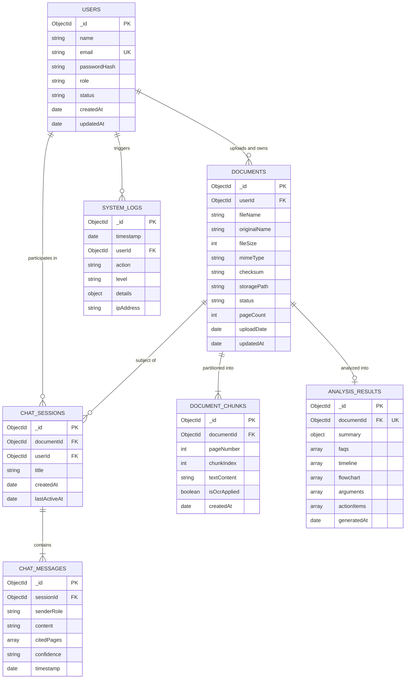

# Database Design Document — NyayaSetu

## 1. Overview and Storage Engine
**NyayaSetu** uses **MongoDB** as its primary datastore. MongoDB's document-oriented (BSON) architecture is well-suited for legal documents, nested procedural flowchart nodes, multi-turn chat threads, and flexible AI-generated schemas.

## 2. Entity-Relationship Diagram (ERD)

## 3. Collection Specifications and Schemas

### 3.1 `users` Collection
Stores registered user credentials, profiles, and role assignments.

| Field Name | Type | Constraints | Description |
|---|---|---|---|
| `_id` | ObjectId | Primary Key, Auto | Unique user identifier |
| `name` | String | Required, Trim, Max 100 | Full name of the user |
| `email` | String | Required, Unique, Lowercase, Indexed | Normalized user email |
| `passwordHash` | String | Required | `bcrypt` hash of user password |
| `role` | String | Enum: `citizen`, `lawyer`, `admin` | User authorization role |
| `status` | String | Enum: `active`, `suspended`, `pending` | Account lifecycle status |
| `createdAt` | Date | Default `Date.now` | Account creation timestamp |
| `updatedAt` | Date | Default `Date.now` | Last update timestamp |

**Indexes:**
- `{ email: 1 }` (Unique)
- `{ role: 1 }`
- `{ status: 1 }`

---

### 3.2 `documents` Collection
Tracks uploaded legal files, verification status, and extraction states.

| Field Name | Type | Constraints | Description |
|---|---|---|---|
| `_id` | ObjectId | Primary Key, Auto | Unique document identifier |
| `userId` | ObjectId | Required, Ref `users`, Indexed | Owner user ID |
| `fileName` | String | Required | Generated internal safe filename |
| `originalName` | String | Required | Original upload filename |
| `fileSize` | Number | Required, Max 26214400 (25MB) | Size in bytes |
| `mimeType` | String | Must equal `application/pdf` | Validated MIME type |
| `checksum` | String | Required, SHA-256 string | Cryptographic hash of file |
| `storagePath` | String | Required | Relative path in storage directory |
| `status` | String | Enum: `uploaded`, `extracting`, `ready`, `failed` | Processing state |
| `pageCount` | Number | Default 0 | Total extracted pages |
| `uploadDate` | Date | Default `Date.now`, Indexed | Creation timestamp |

**Indexes:**
- `{ userId: 1, uploadDate: -1 }` (Compound index for dashboard queries)
- `{ checksum: 1 }`

---

### 3.3 `document_chunks` Collection
Stores paginated text segments to support context retrieval without hitting BSON document limits.

| Field Name | Type | Constraints | Description |
|---|---|---|---|
| `_id` | ObjectId | Primary Key, Auto | Unique chunk identifier |
| `documentId` | ObjectId | Required, Ref `documents`, Indexed | Target document ID |
| `pageNumber` | Number | Required, Min 1 | Source PDF page index |
| `chunkIndex` | Number | Required | Sequential chunk index |
| `textContent` | String | Required | Cleaned text extracted from page |
| `isOcrApplied` | Boolean | Default false | True if extracted via Tesseract |
| `createdAt` | Date | Default `Date.now` | Ingestion timestamp |

**Indexes:**
- `{ documentId: 1, pageNumber: 1 }` (Compound index for ordered page retrieval)

---

### 3.4 `analysis_results` Collection
Stores structured AI outputs produced by Google Gemini.

| Field Name | Type | Constraints | Description |
|---|---|---|---|
| `_id` | ObjectId | Primary Key, Auto | Unique analysis record ID |
| `documentId` | ObjectId | Required, Unique, Ref `documents` | Target document reference |
| `summary` | Object | Required | `{ disputeType, parties, facts, issues, plainText }` |
| `faqs` | Array of Objects | Optional | `[{ question, answer, relevantClause }]` |
| `timeline` | Array of Objects | Optional | `[{ date, event, sourcePage }]` |
| `flowchart` | Array of Objects | Optional | `[{ stepNumber, stageName, description, deadline }]` |
| `arguments` | Array of Objects | Optional | `[{ claim, evidence, counterArgument }]` |
| `actionItems` | Array of Objects | Optional | `[{ priority, action, responsibleParty, deadline }]` |
| `generatedAt` | Date | Default `Date.now` | Generation timestamp |

**Indexes:**
- `{ documentId: 1 }` (Unique)

---

### 3.5 `chat_sessions` and `chat_messages` Collections
Supports multi-turn document conversations with citations.

#### `chat_sessions`
- `_id`: ObjectId (PK)
- `documentId`: ObjectId (Ref `documents`, Indexed)
- `userId`: ObjectId (Ref `users`, Indexed)
- `title`: String
- `createdAt`: Date
- `lastActiveAt`: Date

#### `chat_messages`
- `_id`: ObjectId (PK)
- `sessionId`: ObjectId (Ref `chat_sessions`, Indexed)
- `senderRole`: Enum (`user`, `assistant`, `system`)
- `content`: String
- `citedPages`: Array of Numbers
- `confidence`: String
- `timestamp`: Date

---

### 3.6 `system_logs` Collection
Audit trails and security logging.

- `_id`: ObjectId (PK)
- `timestamp`: Date (Indexed)
- `userId`: ObjectId (Nullable)
- `action`: String (e.g. `AUTH_LOGIN`, `DOC_UPLOAD`, `AI_ANALYZE_FAIL`)
- `level`: Enum (`info`, `warn`, `error`)
- `details`: Object
- `ipAddress`: String

